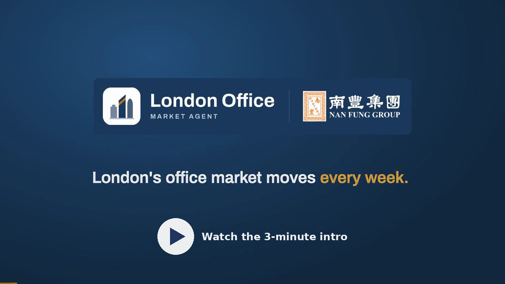

# London Office Market Agent (PoC)

[](docs/pitch/intro-video.mp4)

**3-minute intro video:** [watch or download (MP4, 1080p, 15 MB)](docs/pitch/intro-video.mp4) · [subtitles (SRT)](docs/pitch/intro-video.srt)

An AI agent for a commercial real estate team that watches the London office market (rents, vacancy, take-up,
supply, investment, macro and news), answers questions with every number sourced, and writes the weekly brief.

## Reviewer guide

| | |
|---|---|
| **Live demo** | https://kenneth-london-office.convert-md.com (no login, no key; pick a name on first visit) |
| **Intro video** (3 min) | [MP4, 1080p](docs/pitch/intro-video.mp4) with [subtitles](docs/pitch/intro-video.srt): one minute on the design, two on how to use it |
| **Business deck** | [PDF](docs/pitch/business-deck.pdf) · [PowerPoint](docs/pitch/business-deck.pptx) (6 slides) |
| **User manual** | [PDF, 8 pages](docs/pitch/user-manual.pdf); the same guide is the in-app **Help** page |
| **Code** | this repo; tests: `pytest -q tests` |

**Try the main line in five minutes: Monitor → Copilot → Team brief.**
1. **Monitor**: read the two-sentence team summary, then a signal card: before → after, why it matters, its source.
   Press **Add to brief** on two cards.
2. **Ask Copilot** (button at the bottom right, or Ctrl+K). Try *"What are the main downside risks right now?"*,
   *"Compare Midtown and City Core"* and *"Why did West End vacancy move?"*. Answers stream with sources; **Stop** works.
3. **Team brief**: one brief for the board and the investment committee. Download **Word** or **PDF**, or press
   **Build slides** and change the deck by asking ("swap slides 2 and 3", "theme forest").

**Real or demo.** Bank Rate and news are collected live. Market figures are restated from public Knight Frank
reports for evaluation only (their terms bar AI use, so the app never fetches them; see [Data](#data)).
Internal deals and colleague names are demo data and are labelled as such.

**Run it yourself.** Docker: `cp .env.example .env && docker compose up`, then open http://localhost:8501.
Without Docker: `pip install -r requirements.txt && streamlit run app.py`. Monitor, signals, the brief, Word/PDF
and slides work with no key. The Copilot, PDF reading and the gathering round need Node 22 (`cd pi_engine && npm ci`)
and one model key: `MIMO_API_KEY` (default), `ANTHROPIC_API_KEY` or `OPENAI_API_KEY`. Details are in
[Run it](#try-it-in-three-steps) below.

**How it is built.** One Pi Durable agent engine runs the Copilot and an information agent; 12 Python skills
(`skills/<name>/SKILL.md` + `tools.py`) are its tools, and numbers only ever come from tools. The rest are extras
around that line: the slide editor, the Word/PDF research note, internal deals, the information lifecycle.
More: [features in detail](docs/features.md) · [architecture](docs/architecture.md) ·
[brief as Word/PDF](docs/brief-report.md) · [slides](docs/brief-deck.md) · [internal data](docs/internal-data.md).

## Try it in three steps

```bash
git clone https://github.com/Kenneth0416/nanfengtest.git && cd nanfengtest
cp .env.example .env              # add MIMO_API_KEY (or an Anthropic / OpenAI key) for the Copilot; optional
docker compose up                 # Python + Node 22 + Pi Durable in one image; then open http://localhost:8501
```

Three things to try first: on Monitor, press **Add to brief** on two signals and open **Team brief**; press
**Build slides** there and download the deck; ask the Copilot *"Compare Midtown and City Core"* or *"What are the
main downside risks right now?"*. Without a key, everything except the Copilot, PDF reading and gathering
rounds still works (they are plain Python over the database) and the Copilot says it is offline.

> **Data notice.** The seed figures in `reference/seed/` are restated from Knight Frank's public London office
> research so the PoC has something real to show. Knight Frank's website terms do not permit automated
> collection or AI use of its content, which is why the app itself classifies Knight Frank as an "upload only"
> source and never fetches it. The seed data is therefore **for evaluating this PoC only**; a production
> version would run on the team's own subscribed reports (uploaded by a licensed user), licensed feeds
> (CoStar, EGi, agency data services) and the open data the connectors collect. The BNP Paribas sample PDF
> in `reference/samples/` shows the "swap the source" path working.

## Quick start without Docker

```bash
pip install -r requirements.txt
streamlit run app.py              # web app (recommended); dashboards, brief and slides need no key
python main.py chat                 # or the command line
pytest -q tests                     # the Copilot tests skip (not fail) until Node 22 + `npm ci` are present
```

### Running the agent (Pi Durable)

There is one agent engine: [Pi Durable](https://earendil.com/posts/pi-durable/). The Copilot and the
information agent both run on it. It commits every model turn and tool call to SQLite before showing it,
so if the process dies mid-answer, asking again resumes from the last checkpoint instead of starting over,
and each saved chat keeps its own persistent conversation (one Pi store per person under `data/pi/`, keyed by chat). It needs Node.js 22+, its packages and one key:

```bash
cd pi_engine && npm ci && cd ..
export MIMO_API_KEY=...           # Xiaomi MiMo: Copilot on MiMo-V2.6-Pro-UltraSpeed, information agent and PDFs on MiMo-V2.6-Flash (config.yaml llm.copilot_model / llm.mimo_model / vision.model)
# or
export ANTHROPIC_API_KEY=...      # uses claude-opus-5-5 (configurable in config.yaml)
# or
export OPENAI_API_KEY=...         # uses gpt-5.5
```

The server must be able to reach the model API (api.xiaomimimo.com for MiMo).

Without them the dashboards, signals, brief and sources still work (they are plain Python over the
database), and the Copilot, uploads and gathering rounds say what is missing instead of answering.

### Running on a server

The evaluation instance is public at https://kenneth-london-office.convert-md.com (no login or key).

`docker compose --profile server up -d` adds Caddy (HTTPS, certificate renewal) in front of the app: set
your domain in `deploy/Caddyfile`, put the key in `.env`, and install `deploy/london-agent-collect.timer`
for the daily collection. The app is built to run on a VPS with Node 22, Pi Durable and a shared SQLite database. `reference/`
holds the seed data and the sample PDF and ships with the code; `data/` holds only runtime state
(`agent.db`, Pi Durable's store, uploaded reports), so it can be a mounted volume. SQLite runs in WAL
mode with a busy timeout, so the web app and the scheduled jobs can write at the same time. Schedule
both jobs daily (systemd timer or cron):

```bash
python main.py refresh    # open-data feeds
python main.py gather     # Pi information agent: colleagues' links and tips, open data, new report titles
python main.py housekeep  # lifecycle: advance states, re-score live stories, build the day's digest
```

The Python skills are the tools: Pi Durable calls them through a local HTTP bridge on 127.0.0.1.

## Other commands

```bash
python main.py refresh                  # load seed data + pull live BoE rate and news RSS
python main.py gather                   # one round of the information agent
python main.py process "https://…"      # hand one link or instruction to the information agent
python main.py brief                    # team brief as markdown (one brief for the board and the IC)
python main.py brief --pptx [--theme forest-cream] [--fixed]   # a 3-6 slide deck (up to 12 after edits) under data/exports/, slides chosen by the Copilot from the data (--fixed: rule-picked)
python main.py signals                 # the team's top signals
python main.py ingest reference/samples/sample_bnp_paribas_q2_2025_restated.pdf   # add --save to store
python main.py classify "Visa takes 300,000 sq ft at 1 Canada Square"
python -m pytest -q tests
```

## Architecture

```
connectors/  (pluggable data sources)      skills/  (pluggable agent skills, SKILL.md + tools.py)
  seed_csv     curated research data         market_metrics     trends, snapshots
               (agency reports as uploads)
  boe_rates    Bank of England, live         submarket_compare  side by side, rankings
  news_rss     news feeds, live              supply_and_deals   pipeline, lettings, investment deals
        │                                    macro_watch        Bank Rate, labour market
        ▼                                    news_monitor       search + classify news
  core/classifier.py  detects what each      watchlist_alerts   signal cards, user alert rules
  item is (figure, deal, scheme, macro,      market_brief       team brief (board and IC)
                                             brief_deck         the brief as a PowerPoint: data-driven storyline, 5 themes, 13 layouts
                                             internal_data      our own deals: record, list, confirm, mark quotable
  news) and tags market, theme, sentiment,   report_ingest      PDF extraction + conflict check
                                             market_gather      links/tips, merge, hotness
  importance                                          │
        │                                             ▼
        ▼                                   core/engine.py → Pi Durable (pi_engine/agent.ts)
  core/store.py (SQLite)  ──►  core/signals.py         and info_agent.ts, tools via core/bridge.py
                               ranked cards for team
                                        │
                                        ▼
                         app.py (Streamlit) · main.py (CLI)
```

* **Gathering:** `core/gather.py` (read, classify, match, merge, hotness, report titles),
  `pi_engine/info_agent.ts` (the Pi information agent), `info_skills/` (its playbooks),
  `skills/info_processing` (parsing steps), `pi_engine/common.ts` (bridge and model).
* **Shared library:** `core/library.py` (feeds, freshness, expected reports) and `core/store.py`
  (each source's channel, uploader, upload time and file hash; each figure's status: ok, flagged or rejected).
* **Add a data source:** write `connectors/<name>.py` with a `Connector.fetch()` that returns raw items,
  then list it in `config.yaml`. The classifier decides what each item is; the connector never writes to the store.
* **Add a skill:** create `skills/<name>/SKILL.md` (what it is for) and `tools.py` (a `TOOLS` list), then list it
  in `config.yaml`. The agent's system prompt and tool list are built from these files.

## What is real and what is demo

Every page carries a one-line notice: market figures are restated from public Knight Frank reports (evaluation
only); Bank Rate and news are collected live; the three internal deals and the colleague names are demo data and
say so (a "Demo data" chip). The seed snapshot is loaded, never counted as data collected today; the ONS series
is a seed snapshot, not a live feed; supply items from a report older than two quarters say so and rank lower; the
team summary names the report its long-term averages come from.

## Data

`reference/seed/` holds figures restated from public Knight Frank London office reports (Q1 2024 to Q2 2026,
shown as uploads by "PoC seed", because that is the channel they would use: Knight Frank's terms bar
automated collection and AI use, so the app never fetches from it and the seed is for evaluation only; see
the data notice at the top),
Bank of England and ONS releases, each row linked to its source in `sources.csv`. Some reports have
unlabelled columns; where a mapping was inferred the row says so in `note`. Two deliberate data-quality cases
are kept because they are real: Knight Frank's Q3 2024 report gives London vacancy as both 9.1% and 9.4%, and
its "under construction" series switches from total to speculative-only in Q3 2025. Verify figures against
the originals before external use; a production version would connect to licensed feeds (CoStar, EGi, agency data).

The sample PDF in `reference/samples/` restates BNP Paribas Real Estate's public Q2 2025 figures to show how the
agent maps another publisher's market names and flags where its numbers differ from Knight Frank's.
