# Help

The London Office Market Agent is one shared tool for the whole team. It does three jobs: **Monitor** keeps an eye on the market, **Ask Copilot** helps you make a call, and **Team brief** turns the week into one brief for the board and the investment committee, as a research note or a slide deck. **Sources** is the library behind all three. Every number in the app links to where it came from.

## Getting started

1. Open the app. The first time, pick your name (or type one) and press **Change** later if someone else uses the browser. There is no login: the browser remembers you, and your focus, alerts and conversations are kept under your name.
2. Use the left-hand menu to move between **Monitor**, **Ask Copilot**, **Team brief** and **Sources**. A number beside a name means something is waiting, for example *Team brief · 2* or *Sources · 4 to check*.
3. The round button at the bottom right opens the Copilot from any page. **Ctrl+K** does the same, and **/** puts the cursor in the Copilot's box.

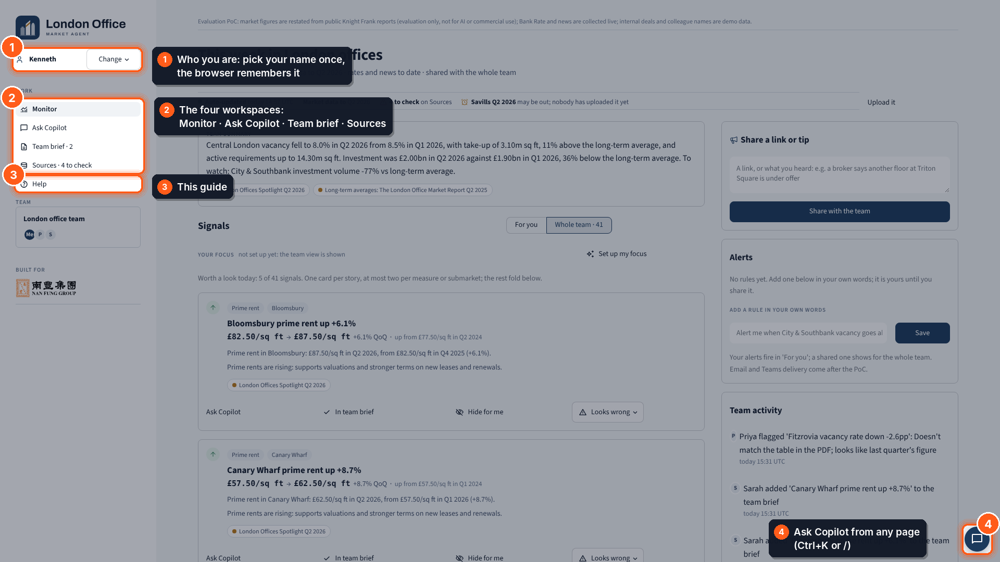

## Monitor

Monitor is the first page. It shows what changed in London offices this week, for the whole team.

### Read the week

1. The **freshness strip** at the top says when open data last came in, which quarter the market data covers, how many figures need checking, and which expected reports nobody has uploaded yet (**Upload it** takes you there).
2. The **team summary** is the week in two sentences. The chips under it are its sources.
3. **Whole team** shows the day's pick for everyone. **For you** shows your own view once you have set up your focus.
4. **Set up my focus** builds that view from one sentence about your job.

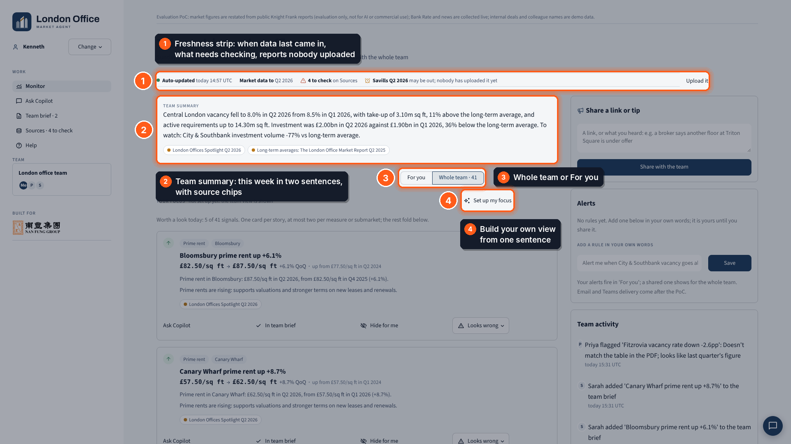

### Use a signal card

Each card is one thing that moved.

1. The title and the numbers line: before → after, the change, and the same quarter a year or two ago.
2. The source chip opens the report the number came from.
3. **Ask Copilot** opens the Copilot already pointed at this signal.
4. **Add to brief** puts the signal in the team brief. It then reads **In team brief**, and anyone can click it to take it out.
5. **Hide for me** hides it from your views only; the rest of the team still sees it.
6. **Looks wrong** flags the number for the team. Say what looks wrong and press **Flag for the team**. The figure stays usable with a warning until someone settles it on Sources.

The pick shows a handful of cards. The rest are folded by category under the last card.

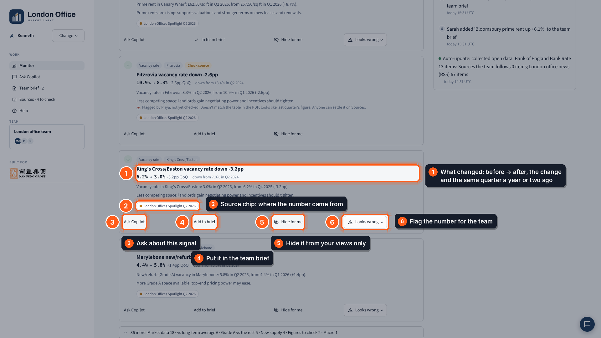

### Share a tip, set an alert, see what the team did

1. **Share a link or tip**: paste a link or write what you heard ("a broker says another floor at Triton Square is under offer") and press **Share with the team**. The agent reads it, checks whether the team already has the story, merges it or adds it, credits you and scores how hot it is. A tip without a published source shows as *Unverified tip* until a link or a second source arrives.
2. **Alerts**: write a rule in plain English, such as "Alert me when City Core vacancy goes above 7%". The app reads it as you type (measure, submarket, condition) and tells you whether it would fire today. Press **Save**. The alert is yours and fires in your *For you* view; **Share with team** gives it to everyone.
3. **Team activity** lists what colleagues added, flagged, uploaded or chose to share, newest first.

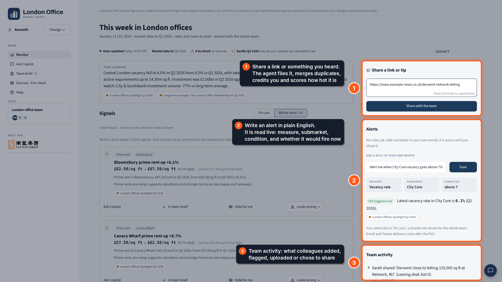

### Set up your own view

1. Press **Set up my focus** and describe your job in one sentence, for example "I manage our West End buildings and report to the board".
2. The Copilot proposes submarkets, measures, how many signals to show, whose wording to use for "why it matters", and alerts set just beyond today's values. Nothing is saved yet.
3. Press **Apply** (or **Discard**). **Clear my focus** goes back to the team view.

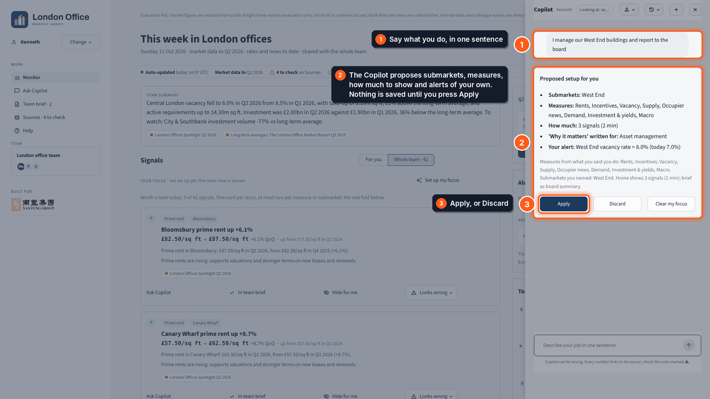

Monitor now opens on **For you**. Your focus is shown above the cards; press **Change with Copilot** or type a one-line change to the Copilot, such as "more Fitzrovia, less macro". The alerts it set are under **Alerts**.

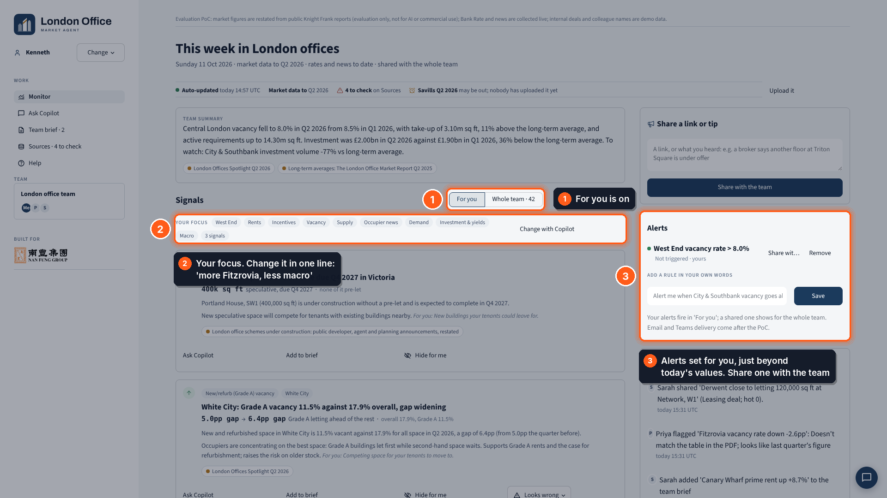

## Ask Copilot

The Copilot answers questions about the London office market from the team's library, in English or Chinese. Every number comes from a tool with its source.

### Start a conversation

1. Pick an example question, or **Set up my focus**.
2. **History** lists your saved conversations.
3. **New chat** starts a clean one.
4. Type your question in the box at the bottom and press Enter.

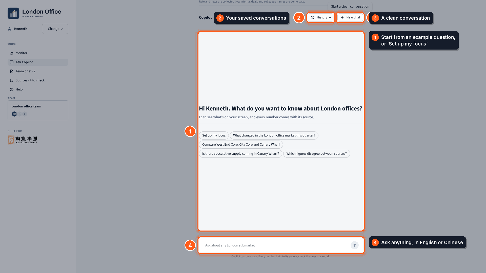

### Watch it work

1. The status line names the tool the Copilot is using ("pulling the trend", "comparing submarkets").
2. The answer appears as it is written.
3. While it writes, the send button becomes **Stop**. Stop keeps what has been written so far.

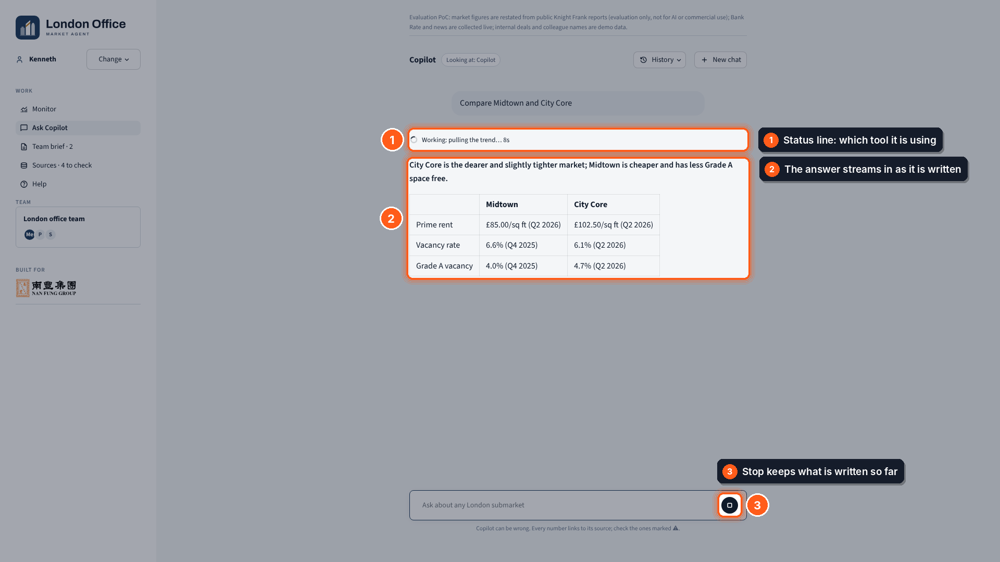

### Read the answer

1. Your question sits on the right.
2. **Worked through N steps** folds away the tools it used; open it to see them.
3. The answer gives each figure with its quarter, so you can see how recent it is.

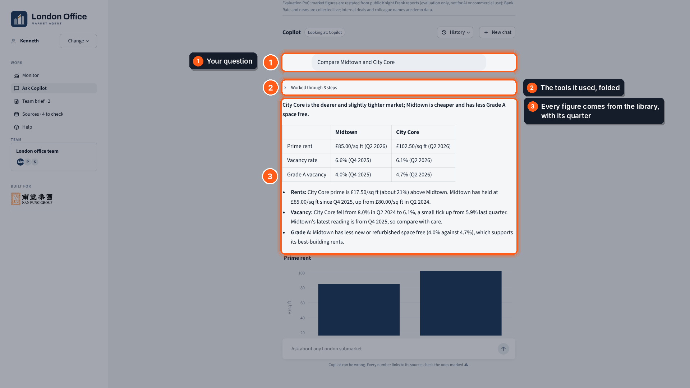

Under the answer:

1. Charts drawn from the same data.
2. **Sources**: each chip opens the report the numbers came from.
3. The action row: copy, good / not useful, ask again, and share to team.
4. Follow-up questions the Copilot suggests. Click one to ask it.

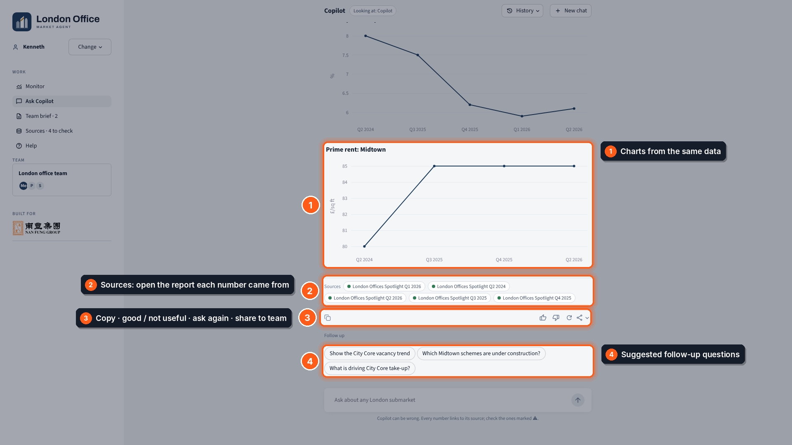

### Stop and ask again

1. A stopped answer keeps what was written and is marked *Stopped*.
2. **Ask again** runs the same question once more.

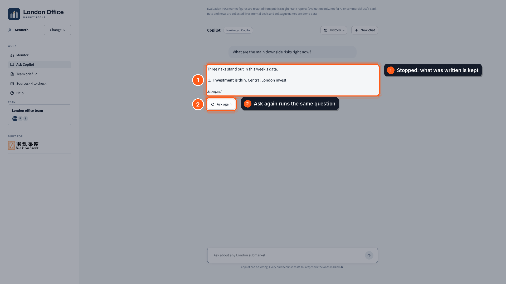

### Find an earlier conversation

Press **History**. Your conversations are listed newest first, with when and how many messages. They are private to you. Click one to carry on where you left off.

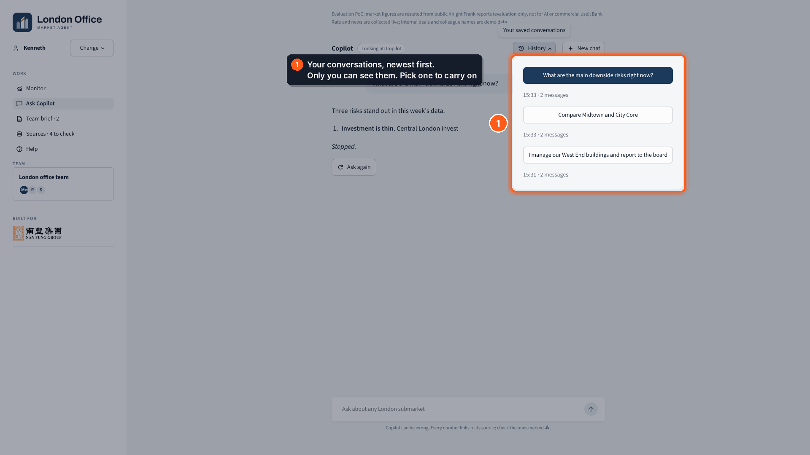

### Share an answer with the team

Answers are private until you share them.

1. Press the share button in the answer's action row.
2. Add a one-line reason if you like ("Useful for Thursday's IC") and press **Share**.

The question, the answer, its charts and sources then appear in **Team activity** on Monitor with your name. A colleague can press **Continue in my Copilot** to carry it on in their own conversation. The row under your answer reads *Shared to team · Undo*; Undo takes it out again.

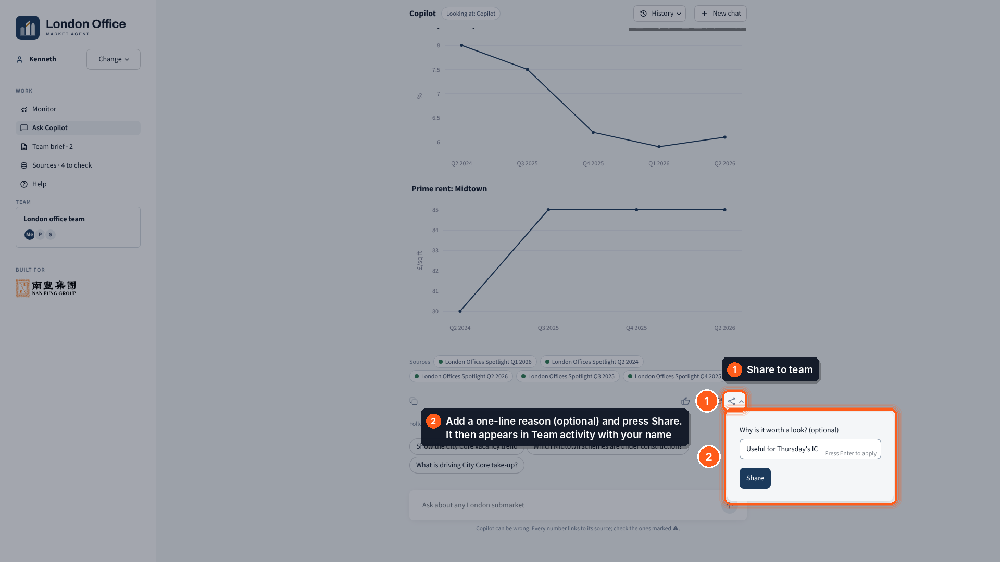

### Ask from any page

1. **Ask Copilot** on a signal card opens the Copilot as a side panel.
2. The panel knows which signal you mean ("About: Bloomsbury prime rent up +6.1%").
3. Ask your own question or pick a suggestion. The page stays visible beside the panel; the X closes it.

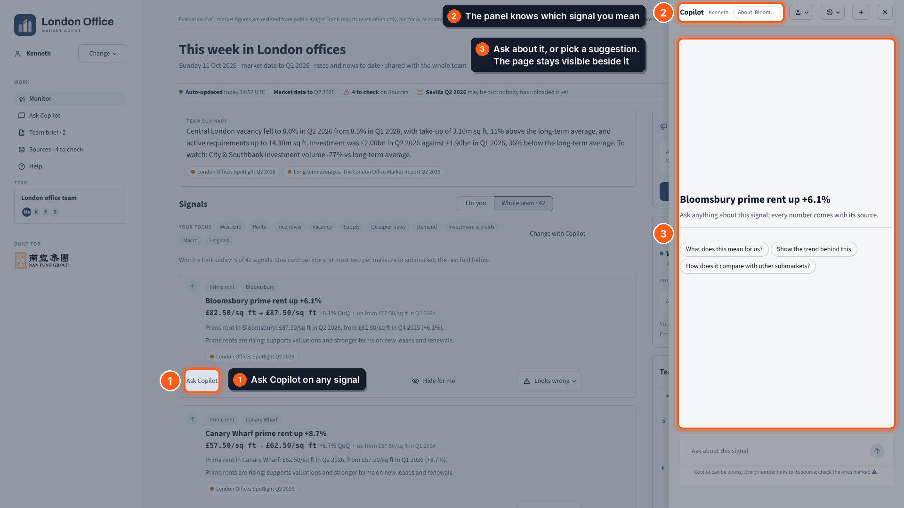

### It keeps working when you leave

You don't have to wait for an answer. Close the panel, open another page or reload: the Copilot keeps writing in the background, and the finished answer is there when you come back. If you come back while it is still writing, it picks up the text from the start. Only **Stop** ends a run. The same is true for the team brief and for slides being built.

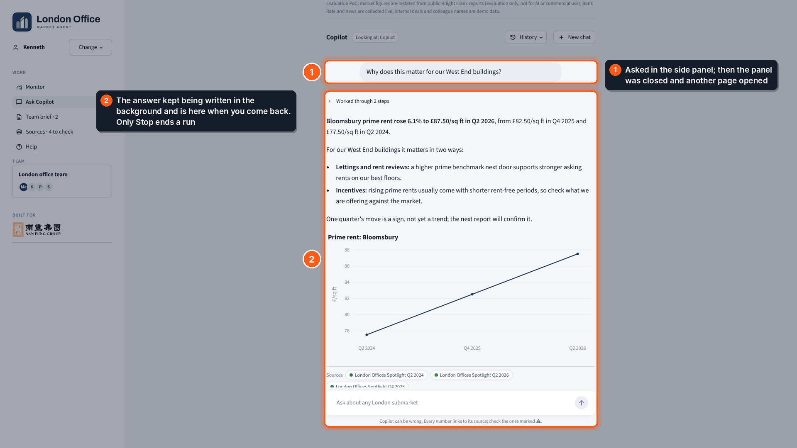

## Team brief

The team brief is written from the signals colleagues added on Monitor, with a footnote on every figure.

### Read and download the brief

1. The signals in the brief, with who added each one. The x removes one; **Add more from Monitor** takes you back to pick more.
2. One brief serves the board and the investment committee: London's key numbers, the evidence table for the team's submarkets, and what supports the case or puts it at risk. Only deals marked quotable are listed.
3. **Word** and **PDF** download the brief as a branded research note. While the files are being made the two buttons wait, greyed out.
4. **Build slides** opens the slide editor (it reads **Slides** once a deck exists).
5. The brief itself. Each [n] points to the Sources list at the end. The brief is written once per state of the data; **Write again** writes it afresh from the same data.

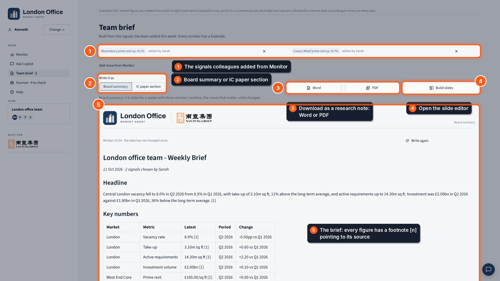

### Build the slides

Press **Build slides**. The slide editor opens over the page. You can watch the Copilot plan the storyline in the right-hand column while each slide appears in the thumbnails as it is laid out. **Stop** keeps what is built. You can close the editor while it builds; the button on the brief reads *Slides · working…* until the deck is ready.

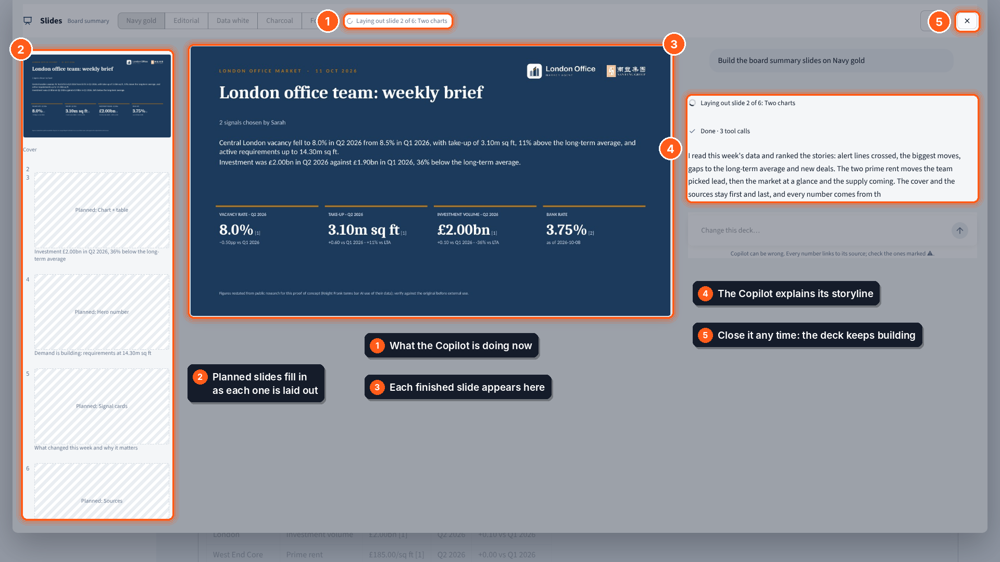

### Work in the slide editor

1. The thumbnails, with page numbers. Click one to open it.
2. The chosen slide, large.
3. The bar under it: previous and next, move the slide up or down, or remove it. The cover and sources stay first and last.
4. The Copilot. Change the deck by asking, in English or Chinese.
5. **Theme**: five house themes. Changing it rebuilds the same slides on the new theme.
6. **Download .pptx** (editable PowerPoint) or **PDF**. Both follow every change.

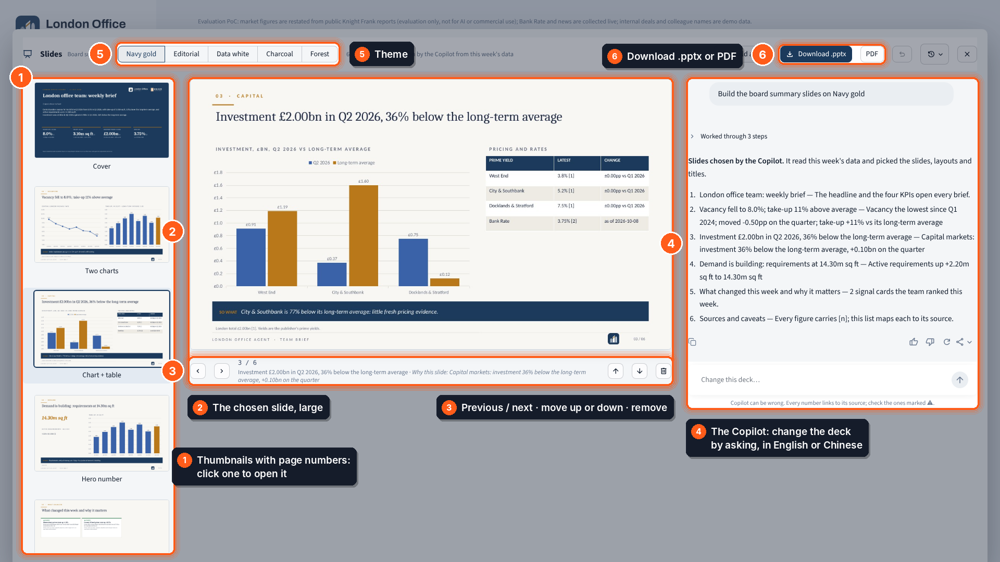

### Change the deck by asking

Type what you want in the editor's chat box, for example:

- "Swap slides 2 and 3", "Remove slide 3", "Add a slide on investment"
- "Make slide 2's title shorter", "Shorten to 4 slides"
- "Only show the last four quarters of vacancy", "as a line chart"
- "Theme forest", "for a client update"
- "需要多兩頁", "刪第3頁，然後換森林主題"

"This slide" means the one selected. The Copilot only uses figures that are in the data; anything else is refused with the current value.

1. Your request.
2. The reply says what actually changed in the deck.
3. **Undo** goes back one step; the version button (v1, v2…) lists every version to go back to.

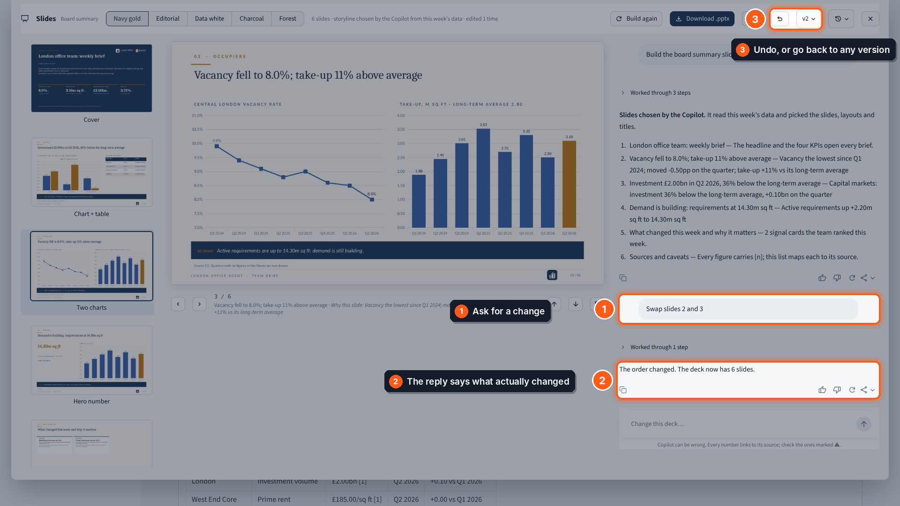

## Sources

Sources is the team's shared library. There are three kinds of source, each shown with a coloured dot and a label: **open data** the agent collects automatically, **reports** colleagues upload, and the company's own **internal data**.

### See the library

1. The counts for each kind of source.
2. **Updates** run daily on the server; **Update now** runs one straight away.
3. **Add a source for the team**: paste a link or name a source (see below).
4. **Needs a person**: figures someone flagged and sources that disagree. Anyone on the team can settle them, and who did shows in team activity.

Below these, the tabs list the library by kind: **Collected automatically**, **Uploaded reports**, **Internal data** and **News and tips**.

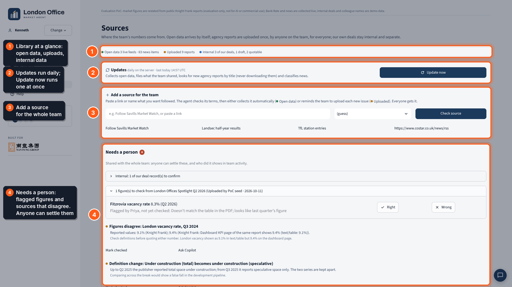

### Settle a flagged figure

1. Open the group of figures to check. Each shows the value, the quarter and why it was flagged.
2. Check it against the report, then press **Right** to keep it or **Wrong** to remove it for everyone.
3. When two sources disagree on the same figure, check them and press **Mark checked**, or **Ask Copilot** about it.

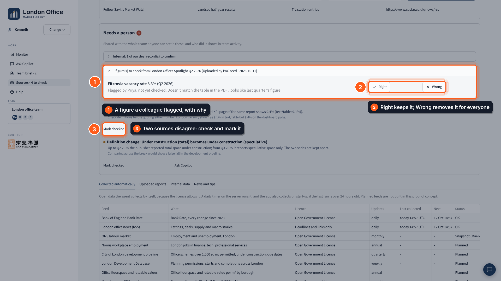

### Add a source for the team

1. Paste a link, or name what you want followed ("Follow Savills Market Watch"), and press **Check source**. You can also tell the Copilot "follow …".
2. The agent reads the site's robots.txt and terms first. If they allow it, the source is collected automatically. If they restrict automated collection or AI use, it becomes upload-only and Monitor reminds the team when a new issue is due. The proposal shows the reason and the sentence from the terms it rests on.
3. Press **Add for the team** to follow it, or **Cancel**.

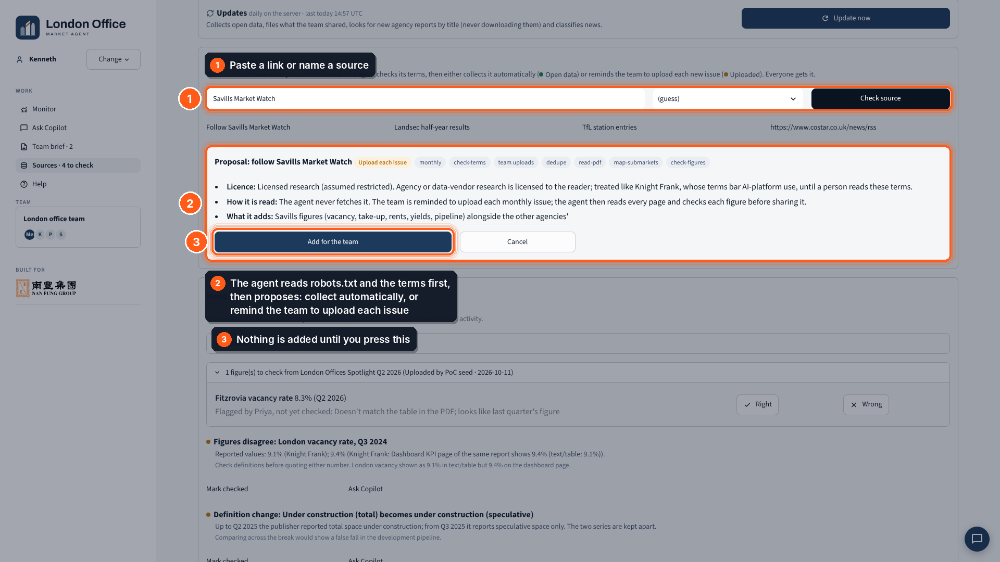

### Upload a report

For reports whose terms bar automated collection or AI use (Knight Frank, Savills, BNP Paribas…), anyone who has access uploads the PDF.

1. Open **Uploaded reports** and drop the PDF (or press **Try the sample**).
2. The agent reads each data page and shows which skills it used.
3. Every figure is listed with its page and three checks: is it in the page text, is it in a plausible range, and does it agree with what the library already holds. Figures that pass are shared as they are. Tick **I checked it** for any you have checked by eye, or untick **keep** to drop one. A page with figures to check is shown under the table.
4. Press **Publish to the team**. If someone has already uploaded the same report, the app says who and when and adds nothing.

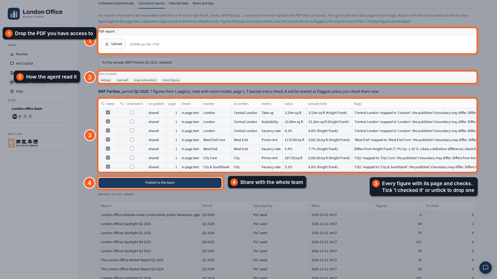

## Good to know

- **Languages**: ask the Copilot in English or Chinese; it answers in the language you use.
- **Keyboard**: Ctrl+K opens the Copilot; / puts the cursor in its box; Esc closes the panel or the slide editor.
- **Privacy**: your conversations, focus and alerts are yours. Only what you share, flag, upload or add to the brief is seen by the team.
- **Data notice**: in this evaluation version the market figures are restated from public Knight Frank reports and are for evaluation only; Bank Rate and news are collected live; internal deals and colleague names are demo data.
