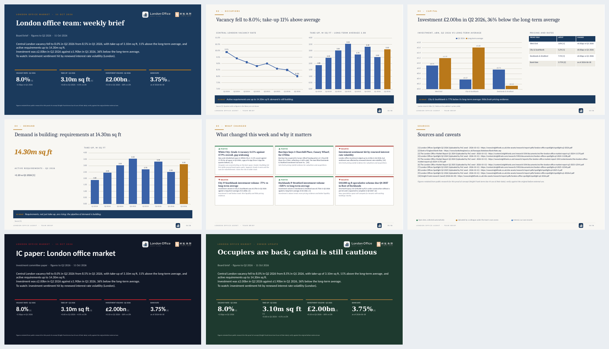
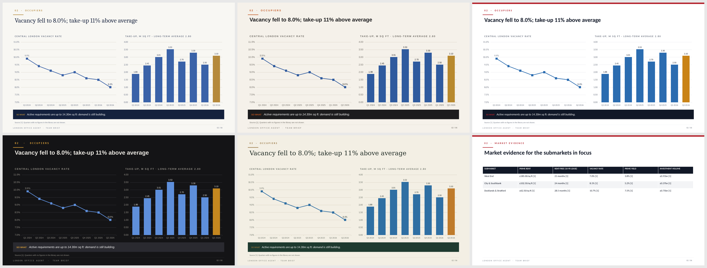

# Brief deck: the team brief as a PowerPoint

`skills/brief_deck` turns the team brief into a 3-6 slide editable PowerPoint (up to 12 after edits). Python owns every
figure, chart, table, KPI tile and footnote; the Copilot (or the default storyline) owns the words.





## Where the design comes from

The design pack (themes, templates, layouts, the build and check scripts) was written for this
project in the "Team brief 輸出 PPT" thread after a feature study of the 193 pptx templates bundled
with Grok Build (`research/grok-template-features.md`, `research/grok-build-pptx-inventory.md`).
What was learned and reused as ideas: a template library described by a style taxonomy (mood,
density, background) rather than by topic; the layout language (tracked uppercase eyebrows, sentence
action titles, short accent rules, cards with a coloured top edge, oversized hero numbers, a dark
"so what" band, a tracked footer); the most common page types (big numbers, numbered pillars,
timelines, one-sentence statements); one emphasised word in a title; and the QA habit of assuming a
deck has problems and checking overlap, leftover text and fonts before looking at every slide.
Grok's bundled templates carry no licence file, so **no template code or file was copied**: every
template here is generated by our own `templates/build_template.js`, and the renderer is our own
python-pptx code. One deliberate difference from Grok's skill: content is filled in by python-pptx,
not by editing a pptxgenjs script, so the figures, footnotes and the number guard stay in Python
where pytest can verify them and the deck builds without a model.

## Structure

```
skills/brief_deck/
  SKILL.md                      what the Copilot reads: six steps, the layouts and keys
  tools.py                      deck_data() + three tools (below)
  themes/themes.json            five themes: colours, fonts, style flags, use_for / mood / density
  templates/<theme>.pptx        one template per theme, 13 named layouts with named placeholders
  templates/build_template.js   regenerates the templates from themes.json (pptxgenjs; dev only)
  templates/finalize_template.py names the placeholders and strips the example slides
  scripts/build_deck.py         spec + data -> pptx; validates the spec, refuses numbers not in the data
  scripts/check_deck.py         post-build QA: count, order, empty or leftover text, overflow, overlap, fonts, numbers
  references/{storyline,layouts,style}.md   served to the Copilot by brief_deck_guide
  examples/{board,showcase}-spec.json       complete specs to start from
```

| Theme | Use for |
|---|---|
| `navy-gold` (default) | team weekly brief and board pack; same brand as the pitch deck |
| `editorial-cream` | research note or commentary for a wider audience |
| `data-white` | IC pack and dense analyst decks |
| `charcoal-amber` | deal or strategy discussion shown on a screen; dark, few words |
| `forest-cream` | client or owner market update |

13 layouts: Cover, Section, Statement, Hero number, Stat row, Chart + takeaway, Two charts,
Chart + table, Numbered pillars, Timeline, Signal cards, Sources, Title only. Chart keys `vacancy`,
`take_up`, `rents`, `investment`; table keys `yields`, `evidence`; hero metrics `vacancy_pct`,
`take_up_msqft`, `investment_gbp_bn`, `active_requirements_msqft`, `bank_rate`.

## How the storyline is chosen (agentic)

The deck is not a fixed template. Every build starts from this week's data and decides what deserves
a slide:

1. `brief_deck_data` returns everything the deck can show (headline, KPIs, chart series, signal cards,
   market talk, our deals (internal), market deals (uploaded), footnotes) **and a ranked list of story candidates**
   under `stories`. `planner.stories()` scores each candidate from the data itself: a watch rule
   crossed on the latest move, the size of the latest change, the gap to the long-term average, new
   requirements, deals recorded this week, a Bank Rate move, and the asker's focus markets. Each
   candidate carries `key`, `score`, `reason`, a suggested `layout`, `title`, `fill` and `so_what`.
2. **Main path, the Copilot (Pi + MiMo).** The Team brief page's Download (.pptx) and the CLI call
   `Engine.build_deck`: the Copilot reads `brief_deck_data`, picks 1–4 content slides from the ranked
   stories (it may also drop, merge or re-layout them), chooses theme, layouts, titles and so-what
   lines, writes a `why` for every slide, calls `build_brief_pptx` with the spec and fixes anything the
   check reports. The `why` lands at the top of the slide notes ("Why this slide: vacancy crossed the
   team's 8% alert line") and in the UI under "Why these slides". Different data gives a different
   deck: the test `test_the_deck_storyline_follows_the_data_not_a_template` runs two seed states (one
   with an alert line crossed and investment above its long-term average) and asserts the slide set
   and layouts differ.
3. **Fallback, rule-picked.** When the Copilot is not ready (no model key, Pi not installed, or the
   model fails to build) `planner.plan_spec` builds the deck from the same ranked stories: Cover, the
   strong candidates (score ≥ 1.5, up to four), Signal cards, Sources. Every slide still carries a
   `why`. The UI labels this build **"Fallback: rule-picked storyline, no model"**; the Copilot build
   shows "Storyline chosen by the Copilot from this week's data".

In both paths the guard is unchanged: charts, tables and hero figures are keys into the data, never
typed numbers, any number in the agent's text that the data does not hold is refused, and
`check_deck` must pass.

## Tools

| Tool | Does |
|---|---|
| `brief_deck_data()` | the data above plus `stories`, the ranked candidates with reasons and suggested layouts |
| `brief_deck_guide(topic)` | `storyline`, `layouts`, `style`, `example`, `showcase`: the design notes the Copilot reads before writing a spec |
| `build_brief_pptx(theme, spec, slides)` | builds `data/exports/<date>-team-brief.pptx`; `spec` is the storyline (each slide may carry `why`); without a spec the rule planner is used; `slides` = {key: {title, notes}} retitles that plan; returns `slides`, `theme`, `storyline` (`copilot` or `rules`), `why` per slide and the check's `problems` |

A spec is `{"theme": ..., "slides": [{"layout", "eyebrow", "title", "so_what", "why", "notes", "fill": {...}}]}`.
`fill` names placeholders; charts, tables and hero figures are keys (`{"chart": "vacancy"}`), never
typed figures; a chart may carry `last` (2-20 periods), `markets` (a list of submarkets) or `type`
(`line`, `bar`, `column`). Any number in the agent's text that `deck_data` does not hold is refused
("numbers not in the data: 6.5"); a title or so-what may quote only the latest value of a series unless
it names the period ("9.9% in Q1 2024"); the refusal comes back structured (`refused_numbers` with the
slide, field and figures, and `latest` with the current values) so the editor can explain it in the
person's language. Also refused: an unknown theme or layout, fewer than 3 or more than 12 slides, a first
slide that is not the Cover or a last slide that is not Sources. Every built slide gets an `id` that the
spec carries through edits. Chinese text is set in Microsoft JhengHei (East Asian font) so it is not
substituted with an italic fallback.

## The slide editor

The floating editor on Team brief changes a built deck by conversation. With the Copilot, the current
spec (and the slide the person is looking at) travels with the instruction, the Copilot revises it and
builds again, and the reply is written from the difference between the old and new spec by slide id:
added, removed, moved, retitled, a changed so-what or chart, a new theme. A revision that would drop a
slide nobody asked to drop is held back with Apply / Keep buttons. Without the Copilot, or when it fails
to answer, the rule editor (`core/deck_edit.py`) applies the same commands in English or Chinese, several
in one message ("remove slide 3, then theme forest" / "刪第3頁，然後換森林主題"): remove, swap and move
(by number, "this slide", "the last slide", "the rents slide", several pages at once), retitle, so-what,
notes, add N slides or a topic or a statement at a position, shorten to N slides, chart range / markets
/ type, theme by name, colour or audience ("for a client update" → forest-cream), undo / restore version
N, export questions and source questions; "make an IC version" says the deck already is one (one brief serves
the board and the investment committee) and offers the data-white theme. Requests that would
need invented data (a Midtown-only slide, a pipeline slide, a logo, a 47.3% that is not in the data) are
answered, not faked. Every state of the deck is kept as a version (up to 20, each with its own files)
so Undo and the version list in the header need no rebuild; the theme control in the header rebuilds an
edited deck on the new theme rather than planning it again.

## Three ways to build

- **Team brief page**: the **Build slides** button beside Word and PDF. Pick a theme in the editor (Navy
  gold by default), then **Download .pptx**. The Copilot plans the deck
  from the data; without a model the rule-picked fallback is used and labelled "Slides picked by rules
  (Copilot offline)". Changing the theme after a build hides the download until the deck is rebuilt, so
  the file you get is always the theme you see.
- **CLI**: `python main.py brief --pptx [--theme forest-cream] [--fixed]`; `--fixed` skips the
  Copilot and uses the rule planner.
- **Copilot chat**: "make the brief into slides", "a client update deck on the forest theme". It reads
  the data and the guide, writes the spec, builds, fixes anything the check reports, and replies with
  the file and one line per slide. When the Copilot is offline the same sentence still gets a deck: the
  app reads the theme from it and builds the rule-picked version, with a download button
  and a note saying so.

## Samples (seed data)

`docs/samples/team-brief-sample.pptx` (navy-gold, with the submarket evidence table and the cards
grouped as supports / risks) and `client-update-forest-cream-sample.pptx` (Statement, Stat row,
Numbered pillars, Timeline), each with a PDF render, built on the rule-picked fallback (the build
server has no model access). `team-brief-board-copilot-sample` and `team-brief-ic-copilot-sample` are
MiMo-planned decks from before the board and IC briefs became one.

## Limits

- The number guard is a string match; it does not pair a figure with its unit.
- `check_deck` estimates text wrapping from an average glyph width (half the point size), so a title that
  just fits in PowerPoint can still be reported; the builder shrinks long titles (cover and content) to fit
  their box, and refuses a Title only slide without a table and an evidence table with no submarkets in focus.
- With fewer than six signals the Signal cards slide hides the unused card frames (covered in the page colour) rather than reflowing to a two-column layout.
- Fonts (Cambria, Calibri, Arial) may be substituted when LibreOffice renders a PDF on a server; the
  .pptx itself is unaffected.
- Rebuilding a template (after a theme change) needs Node and pptxgenjs; the PoC itself needs only python-pptx.
