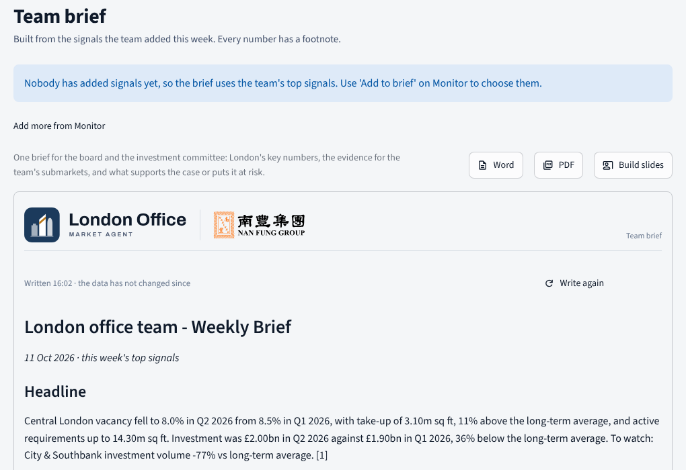
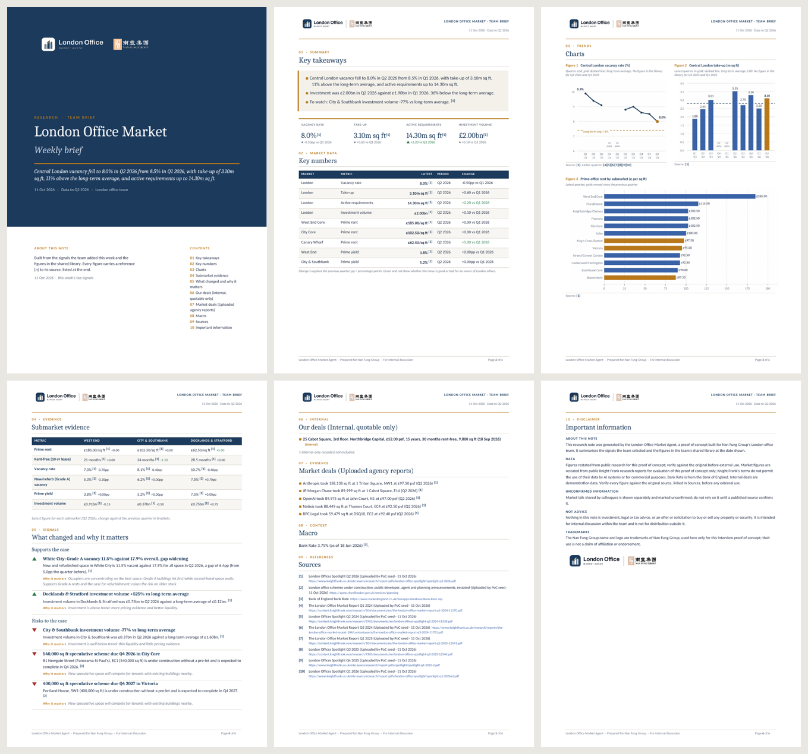

# The brief as a research note (Word and PDF)

The Team brief page offers **Word** and **PDF** download buttons next to **Build slides**. Both are the same
research note, laid out like a broker's research report in the Nan Fung co-brand. The PDF is LibreOffice's
rendering of the .docx itself, so the two never differ.

What is on the pages:

- **Cover.** A full-bleed navy band with the co-brand lockup for dark grounds, the report type, the title, the
  headline's first sentence, the date, the latest data period and the team, then "About this note" and the contents.
- **Running header and footer.** The co-brand lockup and report name on every page; "Prepared for Nan Fung Group ·
  For internal discussion" and "Page X of Y" at the foot.
- **Key takeaways.** The headline, one sentence per line, in a shaded panel, then KPI tiles for London vacancy,
  take-up, active requirements and investment, with the move against the previous quarter in green or red.
- **Key numbers.** The brief's table with a navy header row that repeats on a new page; changes are coloured by
  whether they are good or bad for an owner of London offices.
- **Submarket evidence.** The team's submarkets side by side on prime rent, rent-free, vacancy, Grade A vacancy,
  prime yield and investment, each with its [n] and the quarter's move in green or red. One brief serves the
  board and the investment committee, so this table is always there.
- **Charts.** Vacancy and take-up side by side, then prime rents by submarket, on a true quarterly axis: a quarter
  the library has no figure for is a gap marked "no data" and named in the caption. Each figure has a numbered
  caption and a source line that uses the same [n] as the text.
- **The rest of the brief, as written.** Signals with an up or down marker and "Why it matters", grouped under
  "Supports the case", "Risks to the case" and "Other context", our deals (quotable only),
  market deals, market talk kept apart, macro, and the numbered sources with links.
- **Important information.** About the note, the data (including Knight Frank's evaluation-only terms), unconfirmed
  information, not advice, and trademarks.

How it is made: `skills/market_brief/report.py` reads the cached brief Markdown (no model is called again), draws
the charts with matplotlib from the library, and builds the document with python-docx. The app makes the files in a
background thread the first time the page shows a brief and keeps them under `data/exports/briefs/` against the
brief's text, so the buttons read "preparing…" for a few seconds once and then download at once. Without
LibreOffice on the server the PDF button says so and the Word file still downloads; the Docker image installs
LibreOffice Writer with Carlito and Caladea, which match Calibri and Cambria widths.
